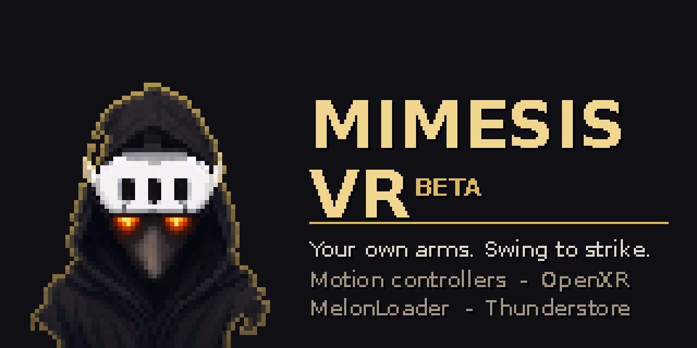

# MIMESIS VR (beta)

An unofficial VR mod for [MIMESIS](https://store.steampowered.com/app/2827200/MIMESIS/) with full motion controller support: your character's own arms follow your hands, melee weapons are swung with your arm, the inventory and the health readout are on your wrists.

> **Beta.** The mod has been tested on a narrow set of hardware only: Meta Quest 3 through Virtual Desktop on two PCs (RTX 5070 and RTX 2060). Other headsets and runtimes should work through OpenXR but have not been checked. Please report what works and what does not (see [Reporting problems](#reporting-problems)).

[Русская версия](https://github.com/Palmmass/MimesisVR/blob/main/README.ru.md)

## Features

- **Motion controls.** Walking with the stick, snap or smooth turning, walking in your room moves the character.
- **Real arms.** The character's own arms and fingers follow the controllers; items sit in the hand.
- **Melee by swinging your arm** - see [Melee: how swinging works](#melee-how-swinging-works).
- **Wrist interface.** Inventory slots on the left wrist (touch a slot to select it), health, contamination and stamina on a watch on the right arm.
- **Emote wheel.** Hold Y and move your hand towards an emote.
- **Remappable buttons** with a controller layout view; the game's prompts show controller buttons instead of keyboard keys.
- **Monitor view for streaming.** The monitor shows the headset picture (one eye) with the watch and wrist panel shown in the corners for viewers.
- **Settings in the headset and in the game menu.** Settings live on a wrist panel (gear icon) and under **Settings → VR** in the game's own menu, which also works without a headset.
- **Performance options** for weaker PCs: render resolution, shadows, draw distance, effects, frame limit.
- **Languages:** English, Russian, Korean (machine translation). More can be added with a text file, see [Translations](#translations).

## Compatibility

- **Playing with others.** Players without VR (and without the mod) can play in the same lobby. Two VR players together have been tested too.
- **Flat mode.** With the mod installed and no headset connected, the game starts on the monitor as usual. When a headset is connected (an OpenXR runtime is running) the game enters VR by itself; **F11** switches VR on and off.
- **Direct3D 11.** VR needs the game to run on Direct3D 11. The mod sets this up on the first start and asks for one restart of the game.
- Tested with game version **0.4.2**. After a game update something may stop working until the mod is updated; the mod writes a warning to the log when the game version differs.

## Requirements

- MIMESIS on Steam (Windows).
- A PC VR headset with an OpenXR runtime: Virtual Desktop (VDXR), Meta Quest Link, SteamVR. Tested: Quest 3 + Virtual Desktop.
- [MelonLoader](https://github.com/LavaGang/MelonLoader) 0.7 (tested with 0.7.3).

## Installation

**With a mod manager (recommended).** Install *MIMESIS VR* from Thunderstore with r2modman or Gale; the manager installs MelonLoader for you. Start the game from the manager.

**Manually.**
1. Install MelonLoader into the game with the official [MelonLoader Installer](https://github.com/LavaGang/MelonLoader.Installer/releases) (choose `MIMESIS.exe`, version 0.7.x). Start the game once and close it.
2. Download `MimesisVR_<version>_melonloader.zip` from [Releases](https://github.com/Palmmass/MimesisVR/releases) and unpack it into the game folder (`...\steamapps\common\MIMESIS`), so that `Mods\MimesisVR.dll` ends up next to the game's `Mods` folder.
3. Start your headset runtime (for example Virtual Desktop), then start the game. On the very first start the mod switches the game to Direct3D 11 and asks for a restart.

To remove the mod, delete `Mods\MimesisVR.dll`, `UserLibs\UniverseLib.Mono.dll` and the `UserData\MimesisVR` folder (your settings are kept there).

## Controls (default)

| Control | Left controller | Right controller |
|---|---|---|
| Stick | Move | Turn (snap 45°); up/down - inventory slot |
| Stick click | Run (toggle) | Reload |
| Trigger | Second action (the game's right mouse button) | Attack / use item |
| Grip | Voice (push to talk) | Interact: take, open, press |
| Buttons | X - status screen, Y (hold) - emote wheel | A - jump, B - drop the item in hand |
| Menu | Game menu | - |

- **Pointing.** Interaction and item actions go where the right hand points (can be switched to gaze).
- **Inventory.** Look at your left wrist; touch a slot with the right hand or point at it to select it.
- **Settings.** Press the gear at the elbow end of the right watch, or open **Settings → VR** in the game menu.
- **Recenter:** F10. Every button can be remapped on the *Buttons* tab; *Show the layout* draws both controllers with their current actions.

## Melee: how swinging works

With a melee weapon in hand, a fast swing of the right arm starts a hit (the trigger works too; *Hands & items → Melee hit*: Button / Swing / Both).

The swing does **not** use physics. It presses the game's own attack button at the start of your swing. Everything else is still done by the game: the wind-up before the blow, the time you must wait before the next hit, the damage and the reach. You cannot hit faster or harder by waving the arm faster.

This is deliberate. Physical melee (damage from the speed of the hand, hits whenever the weapon touches) would let a VR player hit far more often than the game allows, ignore the wind-up and stagger monsters that are balanced around these timings. That breaks the balance against both the monsters and the players without VR in the same lobby.

So swing **in the game's rhythm**: swing, let the blow land, wait for the short "ready" vibration, swing again. Vibration tells you what happened: one pulse - swing registered, three - hit, two - miss, one short - you can hit again. If hits start by accident, raise *Swing: hand speed*; if swings are missed, lower it.

## Settings and performance

All settings are on the wrist panel and in **Settings → VR**. On a weaker PC try, on the *Performance* tab: lower *Headset resolution*, turn off *Lamp shadows*, shorten *Draw distance*, or pick a lower *Preset*. *Picture on the monitor = Off* saves a lot when you do not need the monitor.

Settings are stored in `UserData\MimesisVR\MimesisVR.cfg`; *Service → Reset all settings* returns the defaults.

## Translations

The mod's texts can be translated with a plain text file, no programming needed:
1. Turn on *Service → Debug tools* and press *Write a language file template*. The file appears in `UserData\MimesisVR\Lang\`.
2. Each text is an `@ English` line followed by a `= translation` line. Fill in the translations and save the file as `<code>.txt`, using the game's language code: `ja`, `zh_cn`, `zh_tw`, `de`, `fr`, `es`, `pt_br`, `it`, `pl`, `tr`, `vi`, `th`, `da`, `uk`, `ar`.
3. Restart the game; the language appears in the language list. Corrections to the Korean translation are welcome the same way (`ko.txt`).

Please send finished files as an issue or a pull request so they can be included in the mod.

## Reporting problems

Open an [issue](https://github.com/Palmmass/MimesisVR/issues) and attach `MelonLoader\Latest.log` from the game folder. Say which headset and runtime you use, your video card, and what you did before the problem appeared.

## Building from source

See [BUILDING.md](https://github.com/Palmmass/MimesisVR/blob/main/BUILDING.md).

## Credits and license

Made by **Palmmass** together with **Claude** (Anthropic's AI assistant), which wrote most of the code.

Based on [UnityVRMod](https://github.com/NewUnityModder/UnityVRMod) by NewUnityModder. MIMESIS VR is free software under the [GNU General Public License v3.0](https://github.com/Palmmass/MimesisVR/blob/main/LICENSE). Third-party components and their licenses are listed in [NOTICE.md](https://github.com/Palmmass/MimesisVR/blob/main/NOTICE.md).

MIMESIS is a game by ReLU Games, published by KRAFTON. This mod is not affiliated with or endorsed by ReLU Games or KRAFTON. The mod contains no game files. Use it at your own risk; play in lobbies where everyone agrees to it.
